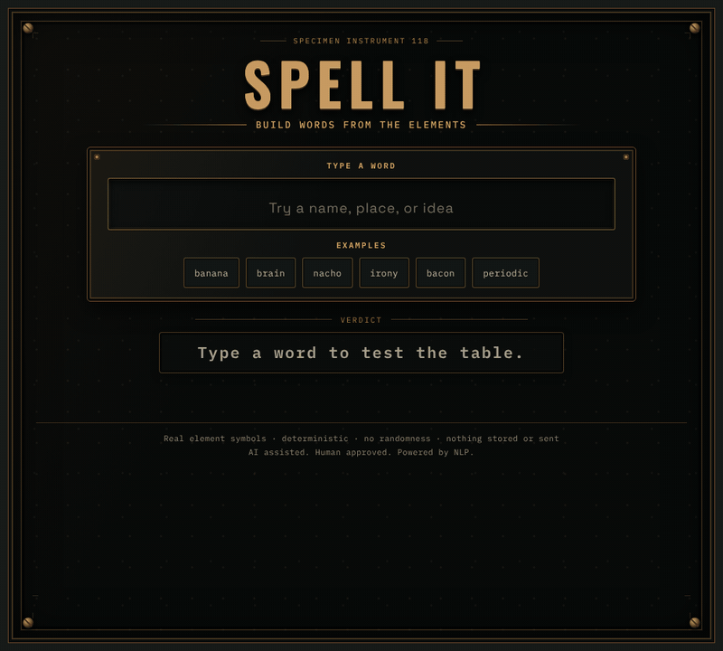
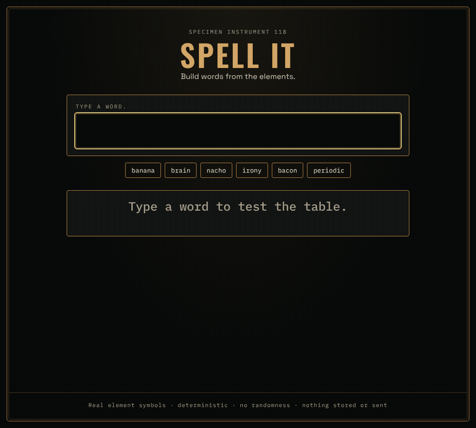
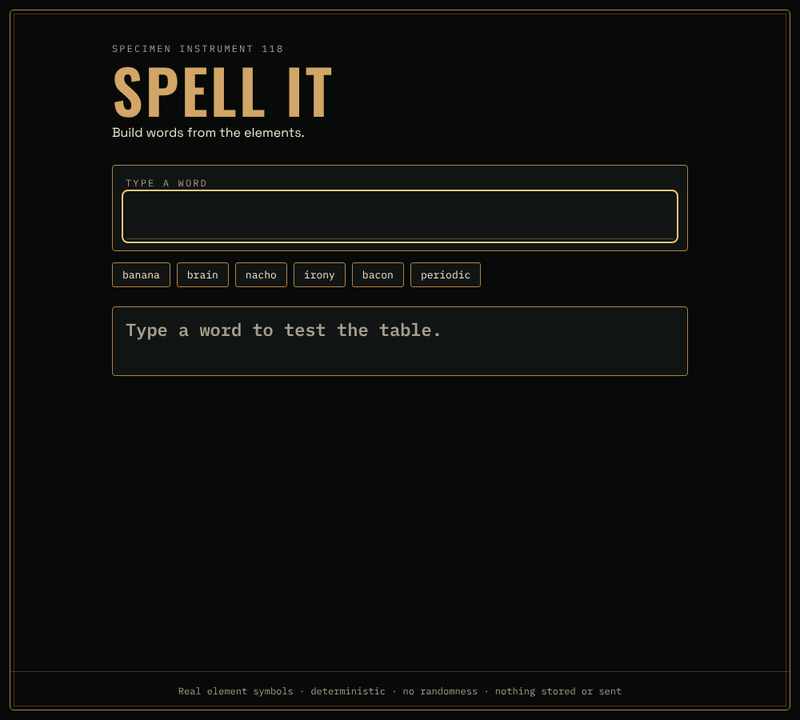

# Ponytail x Spell It

**Same PRD. Same model. Same prompt. One build with the [Ponytail](https://github.com/DietrichGebert/ponytail) ruleset off, one with it on, both compared against the version I built by hand last summer.**

Short version: Ponytail made the app about half the size, a little cheaper and faster, with no must-fix bugs. It also took out the parts I liked.

---

## The problem

AI coding agents tend to build more than you asked for. Extra abstractions, extra files, a library where the browser already has the feature. The code works, but it's bigger than it needs to be, and bigger code is harder to read, review, and trust.

[Ponytail](https://github.com/DietrichGebert/ponytail) is an open source ruleset that tries to fix that. It tells the agent to act like "the laziest senior dev in the room" and climb a ladder before writing anything:

1. Does this need to exist?
2. Is it already in this codebase?
3. Does the standard library handle it?
4. Is there a native platform feature?
5. Is there an installed dependency?
6. Can it be one line?
7. Only then, the minimum code that works, plus one small test if the logic is non-trivial.

Its own benchmark reports about 53% less code, 41% less time, and 26% lower cost. I wanted to see what that looks like on one small app of mine, and what it costs in ways a line count doesn't show.

## How this tests it

I picked **Spell It**, one of my [Hot AR Summer 2026](https://github.com/earlgreyhot1701D/hot-ar-summer-2026) daily builds. You type a word and it builds that word out of periodic table symbols, like `Ba · Na · Na` for banana. Letters no element covers get flagged.

It's a good test case because it has:

- **Real logic.** Finding the spelling that places the most letters is a small search problem, so Ponytail's "add a test" rule has something to bite on.
- **Room to over-build.** A solver framework, a dictionary API, settings, history.
- **A finished original to compare against.** I already built it by hand, with a deliberate design.

Then I wrote one [PRD](PRD.md) from the original's behavior, with MUST, STUB, and NEVER labels, acceptance checks, and the original's visual theme. Both builds got that PRD and nothing else.

## See it

All three run the same demo: type "banana", click "periodic", type "jazz".

### Original (built by hand, summer 2026)



### A: Claude Code, Ponytail off



### B: Claude Code, Ponytail full



## The setup

| | Original | A | B |
|---|---|---|---|
| Built by | Me, summer 2026 | Claude Code (desktop) | Claude Code (desktop) |
| Model | n/a | Opus 5.5 | Opus 5.5 |
| Ponytail | n/a | `/ponytail off` | `/ponytail full` |
| Input | n/a | [PRD.md](PRD.md) + one prompt | [PRD.md](PRD.md) + one prompt |
| Folder | `spell-it-original/` | `spell-it-a/` | `spell-it-b/` |

Each build ran in a fresh session, in an empty folder holding only the PRD, with no personal rules files (`CLAUDE.md` or `AGENTS.md`). Both got this exact prompt:

```
Build the app described in PRD.md. Put it in one index.html in this folder. When you're done, tell me how to check it against the acceptance checks.
```

I didn't help with code. I was ready to send a one-line follow-up for any failed check, but neither build needed one.

## Results

### Size

| | Original | A: off | B: full |
|---|---|---|---|
| JavaScript lines (logic) | 319 | 151 | 109 |
| CSS lines (the look) | 595 | 227 | 61 |
| **Total lines** | **989** | **416** | **206** |
| Files | 1 | 1 | 1 |
| Dependencies | 0 | 0 | 0 |

### Does it work?

| | Original | A: off | B: full |
|---|---|---|---|
| Acceptance checks | 9 of 9 | 8 of 9 | 9 of 9 |
| MUST features | 13 of 13 | 13 of 13 | 13 of 13 |
| NEVER rules kept | 5 of 5 | 5 of 5 | 5 of 5 |
| STUBs left as comments, not code | n/a | 2 of 2 | 2 of 2 |
| Self-tests written | 0 | 7 | 8 |

The one failed check: pasting a 10,200-letter word froze Build A for 1.1 to 1.8 seconds per keystroke. Build B paused for about 0.3 seconds. The original caps input at 80 letters, so it never gets that long.

### Cost and time

| | A: off | B: full |
|---|---|---|
| Build cost | $0.85 | $0.73 |
| Build time | 1m 49s | 1m 29s |
| Follow-up prompts | 0 | 0 |
| Review + audit cost | $0.33 | $0.32 |

Running the whole experiment, including all three audits, cost about **$2.65**.

### Compared with Ponytail's own benchmark

| | Ponytail's benchmark | This test (B vs A) |
|---|---|---|
| Less code | about 53% | about 50% (206 vs 416 lines) |
| Less time | about 41% | about 18% (20 seconds) |
| Lower cost | about 26% | about 14% (12 cents) |

The code savings matched their claim. Time and cost savings were real but smaller on an app this size.

### What the Ponytail audits found

| | Original | A: off | B: full |
|---|---|---|---|
| Must-fix | 1 | 1 | 0 |
| Should-fix | 4 | 1 | 2 |
| Nice to have | 2 | 3 | 3 |
| **Total** | **7** | **5** | **5** |

- **Original:** a leftover placeholder for the social share image.
- **A:** the long-paste freeze.
- **All three:** screen readers read too much on every keystroke. That one is on my PRD, not on any builder.

Full output is in [audits/](audits).

### My gut score (would I ship it as is?)

| Original | A: off | B: full |
|---|---|---|
| 5 | 4 | 4 |

All three work the same. The original wins on detail: the background, the frame, the big title. A and B are one-shots that would need small UI tweaks.

## What I learned

1. **Ponytail does what it says.** Half the code of the plain build, same behavior, and the only build with no must-fix bugs.
2. **Most of the cut came from the design.** B has about a tenth of the original's styling. "Write less code" quietly became "make it plainer," and I scored the plain ones lower. Lean code and good design are different goals.
3. **A good PRD did a lot of the work.** The plain build was already less than half the size of my original. Clear MUST, STUB, and NEVER labels kept both agents in scope.
4. **The one real bug went to the build without Ponytail.** Build A froze on a huge paste. Build A also told me it showed results "right away"; its own review later admitted it had only checked that it worked, not how fast.
5. **Summer me already had the fix.** The audit's fix for that freeze was to cap the input length. My original has done that since July.
6. **Check the judge too.** The audits found real bugs, and also called my "Powered by NLP" tagline a false claim, described the project as college-affiliated, and suggested a test where "banana" spells as B·A·Na·Na. A is not an element symbol.

## Limits

- One small app, one run per build. This is a case study, not a benchmark.
- The PRD was written from the original, so the original had a head start on matching it.
- A and B were audited in the same session that built them. The original was audited in a fresh one.
- Not tested with a real screen reader or on a real phone.

## Run it yourself

**Try the apps:** download any `index.html` and double-click it. No build step.

**Repeat the experiment:**

1. Install Ponytail in Claude Code (see the [Ponytail README](https://github.com/DietrichGebert/ponytail)).
2. Make two empty folders and put [PRD.md](PRD.md) in each.
3. In a new session in the first folder, send `/ponytail off`, then the prompt above.
4. In a new session in the second folder, send `/ponytail full`, then the same prompt.
5. Score both against the acceptance checks in the PRD.

## What's in here

```
PRD.md               the spec both builds got
spell-it-original/   built by hand, summer 2026
spell-it-a/          Claude Code, Ponytail off
spell-it-b/          Claude Code, Ponytail full
gifs/                same demo on each build
results/             full scorecard
audits/              raw Ponytail review and audit output
```

## Credits

- [Ponytail](https://github.com/DietrichGebert/ponytail) by Dietrich Gebert, MIT.
- Spell It and this experiment by [L. Cordero](https://github.com/earlgreyhot1701D).

## License

MIT. See [LICENSE](LICENSE).

---

AI assisted. Human approved. Powered by NLP.
